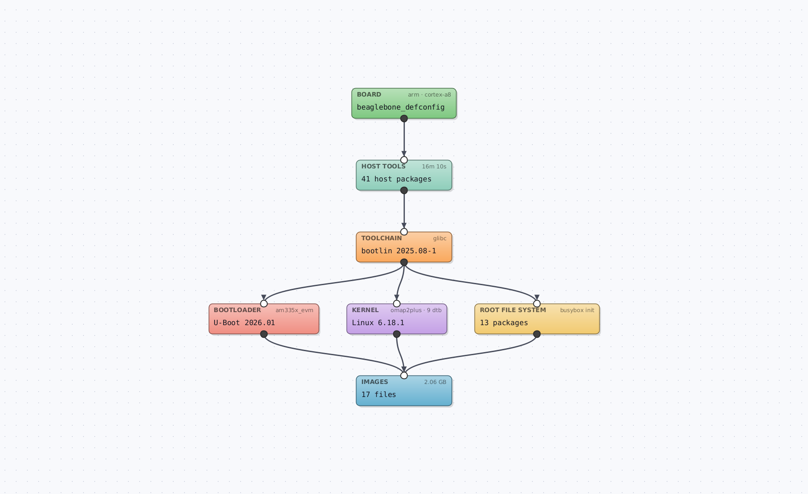
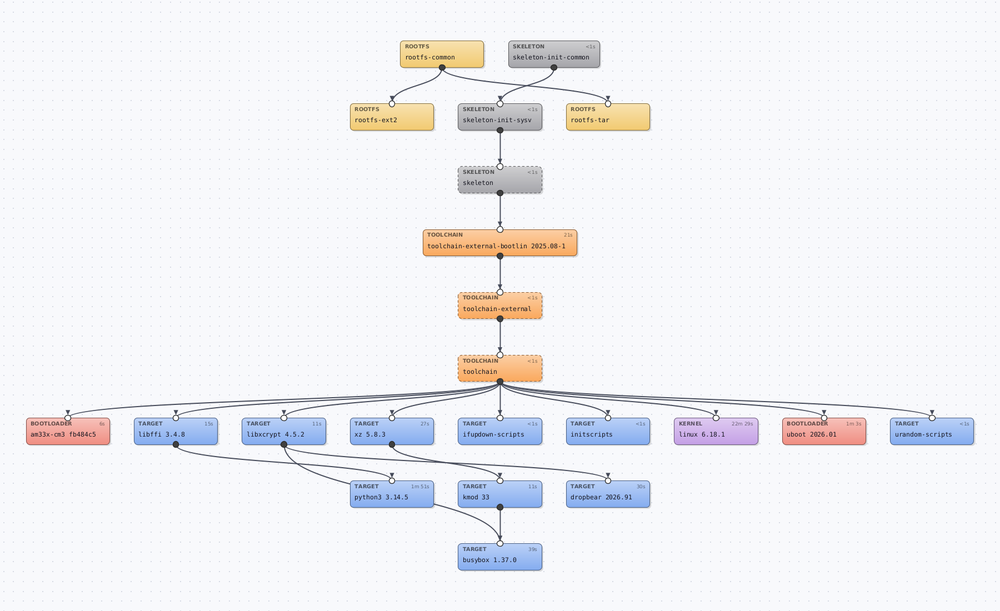
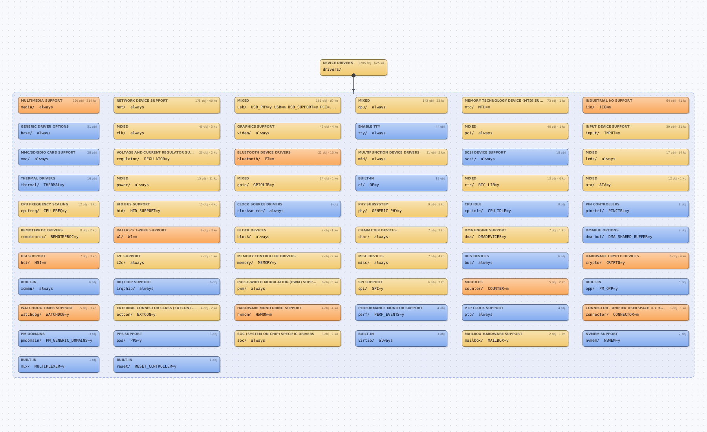

# The Grid

A Java Swing app that shows a Buildroot build as blocks, in the style of EVIA Paradigma
(same block shape, colors, ports, wires and dot grid; FlatLaf when the EVIA jar is installed).

**Download:** the AppImage from [Releases](https://github.com/sbrutyan01/The-Grid/releases/latest), then
`chmod +x The-Grid-*.AppImage && ./The-Grid-*.AppImage`.

    ./run.sh ~/evia-linux/buildroot-bbb      # a workspace with output/, or an output folder itself

Needs Java 17+ (tested on 25). No other dependencies.

## Views

- **System**: Board → Host tools → Toolchain → Bootloader / Kernel / Root file system → Images.
  Double-click a block to jump to its package(s).
- **Packages**: every package as a block. A wire goes from a dependency down to the package that
  needs it, so things built first are on top. Click a block to light up what it needs (green) and
  what needs it (orange). Double-click a block to read its `.mk` file.
  - *Host packages*: also show `host-*` tools.
  - *Direct wires only*: hides A→C when A already reaches C through other blocks.

- **Kernel**: what the Linux build compiled, folder by folder (drivers, net, fs, arch, …). Each block
  shows its Kconfig menu title, how many object files and modules (`.ko`) it produced and the
  `CONFIG_` option that turns it on. Blue = built into the kernel image, orange = modules only,
  yellow = both. Double-click a folder to go in (drivers → usb → …), the top block to go back.
  Read from the kernel build folder: `.config`, the `.o` files, `modules.order`, `built-in.a`,
  each folder's Makefile and Kconfig.

Each block shows its build time (from `build/build-time.log`). The panel on the right shows
version, licenses, dependencies, build steps, sources and so on.

Mouse wheel zooms, dragging empty space pans, dragging a block moves it. Keys: `F` fit,
`0` 100 %, `+`/`-` zoom, `Esc` deselect, `Ctrl+F` find, `Ctrl+O` open.

## Where the data comes from

- `make show-info` in the output folder: packages, versions and dependencies. Takes about 10 s and
  only reads; the result is cached in `~/.cache/the-grid/` until `.config` changes.
  **Reload** runs it again. If `make` fails, packages are read from `build/`, without dependencies.
- `.config`: board, CPU, kernel, U-Boot, toolchain, init system, root FS formats.
- `build/build-time.log`, `images/`, and `evia-linux.json` when EVIA Paradigma made the workspace.

## Headless PNG

    java -Djava.awt.headless=true -cp classes brblocks.BuildrootBlocks --png out.png [--packages] [--host] [--kernel drivers/usb] <folder>

## AppImage (Ubuntu and other x86_64 Linux)

    packaging/appimage.sh        # -> dist/The-Grid-1.0.0-x86_64.AppImage (about 34 MB)

One file with its own trimmed Java runtime and FlatLaf 3.8 inside, so nothing needs installing.
Run it with `./The-Grid-1.0.0-x86_64.AppImage [folder]`. Building needs a JDK with jpackage and
internet access the first time (FlatLaf from Maven Central, appimagetool from GitHub).
`make` still has to be installed on the machine for the dependency wires.
